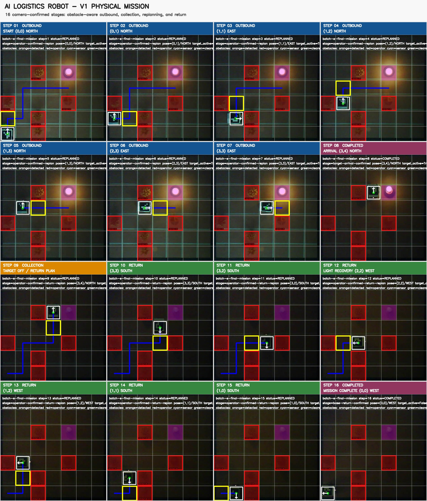
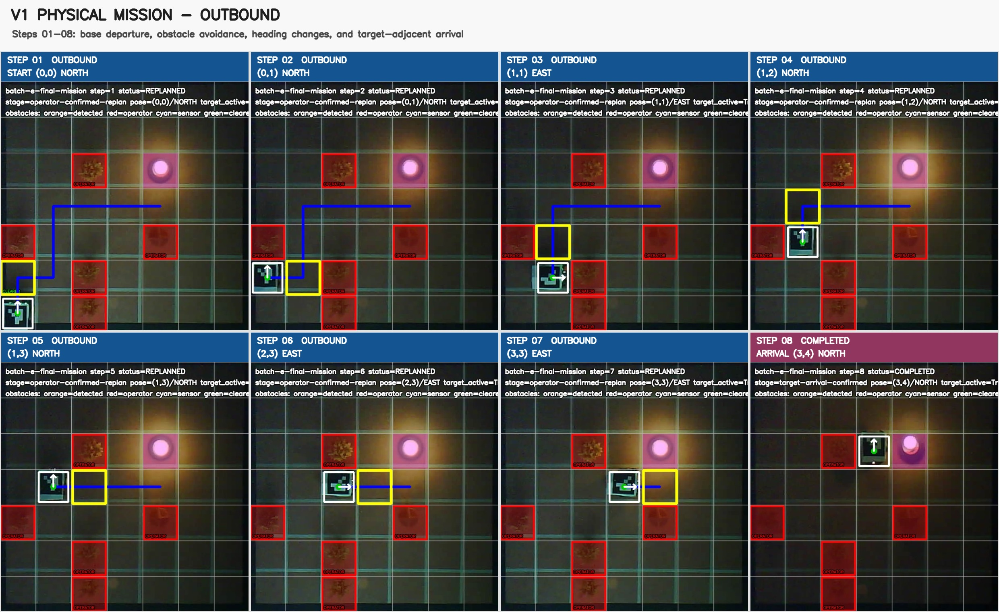
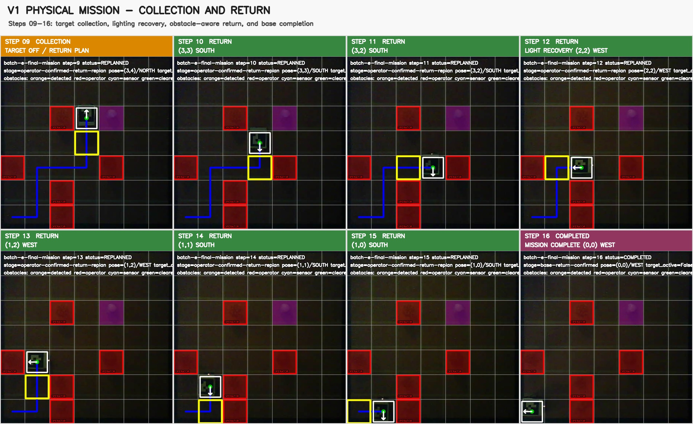

# AI-Logistics-Robot

AI-Logistics-Robot is a modular autonomous-logistics-robot project developed
through simulation first and physical integration second.

The Version 1 mission is triggered by a light target. One robot travels to a
safe cell near that target, avoids confirmed obstacles, simulates collection,
replans from camera-confirmed physical poses, and returns safely to its base.



*Sixteen camera-confirmed stages of the assisted physical V1 mission: departure
from base, obstacle-aware outbound planning, target-adjacent arrival, collection,
lighting recovery, replanned return, and confirmed base completion.*

## Current status

### I-1.0 physical vision and assisted end-to-end integration - Validated

I-1.0 connects the validated simulation architecture to the physical robot
platform and now includes a camera-confirmed assisted end-to-end V1 mission.

The current I-1.0 implementation includes:

- stable JPEG capture from a fixed overhead ESP32-CAM;
- a calibrated 7 by 7 grid covering 140 cm by 140 cm;
- perspective rectification from 800 by 600 to 700 by 700 pixels;
- versioned YAML calibration and reviewable reference images;
- live calibrated grid capture;
- ArUco robot identification with marker `0` from `DICT_4X4_50`;
- conversion of marker centers into logical grid positions;
- conversion of marker rotation into cardinal robot headings;
- explicit rejection of missing or ambiguous robot localization;
- an annotated robot-pose diagnostic for offline and live frames;
- a physical `PerceptionPort` adapter producing immutable timestamped snapshots;
- a versioned `ALR|1` Arduino protocol and sequenced host client;
- a separate supervised firmware that boots in `ESTOPPED/LATCHED`;
- supervised `STOP` execution with matching `ACK/DONE`, physically validated
  through both the serial monitor and the Python client;
- bounded supervised `MOVE_FORWARD`, `TURN_LEFT`, and `TURN_RIGHT`
  execution with matching `ACK/DONE`, local safety intervention, and absolute
  time bounds;
- an explicitly authorized Python bounded-motion diagnostic that verifies
  preflight sensors and restores `ESTOPPED/LATCHED`;
- a physical `ControlPort` implementation that accepts success only after
  exact camera confirmation of the expected grid cell and cardinal heading;
- a guarded camera-confirmed motion diagnostic, exercised physically with
  exact success acceptance and safe rejection of unconfirmed outcomes;
- a read-only serial diagnostic physically validated on COM3;
- read-only five-sensor telemetry and typed Python snapshots, physically
  validated while the controller remained `ESTOPPED/LATCHED`;
- deterministic interpretation of infrared, boundary, ultrasonic, and
  photoresistor readings;
- automatic lamp-off ambient calibration with conservative drift tracking;
- debounced target-light activation using validated relative thresholds;
- fused live camera and Arduino perception producing immutable physical
  `PerceptionSnapshot` values;
- validated camera proposals for changed grid cells with explicit operator
  confirmation or rejection;
- persistent physical-obstacle evidence consumed by A* replanning;
- automatic cardinal-heading derivation for every adjacent transition;
- assisted outbound, collection, and return evidence with exact pose
  confirmation at every accepted stage;
- reproducible annotated mission evidence and sixteen-stage visual storyboards.

Synthetic localization verifies all four cardinal headings and the complete
image-to-domain coordinate conversion. The printed 8 cm by 8 cm marker is now
physically validated at the grid center in all four orientations and across
all four operational corner cells.

A small expected parallax remains near the outer boundaries because the marker
is elevated above the calibrated floor plane. Physical navigation will
therefore target cell centers.

The physical `PerceptionPort` software boundary is implemented and validated
with both synthetic frames and live fused camera-and-Arduino observations.
The safe microcontroller handshake is physically connected through COM3 and
validated with `PING`, `STATUS`, `REARM`, and `ESTOP`. The supervised `STOP`
command was accepted in both safety states and completed through matching
`ACK` and `DONE|OK` responses from both the serial monitor and the Python
client.

A 250 ms supervised `MOVE_FORWARD` primitive is also physically validated.
Normal completion, ultrasonic `BLOCKED`, boundary-triggered emergency stop,
active `STOP`, active `ESTOP`, and bounded host disconnection all stopped the
motors safely. The guarded Python diagnostic verifies clear preflight sensors,
requires explicit wheels-lifted authorization, and restores
`ESTOPPED/LATCHED` after execution.

The read-only `SENSORS` path was physically validated through both the Arduino
Serial Monitor and the Python client. Both infrared obstacle sensors, the
downward boundary sensor, the HC-SR04 distance sensor, and the photoresistor
produced valid typed snapshots while every wheel remained stationary.

Raw readings are now converted into local obstacle, critical boundary-hazard,
and debounced target-light facts. Lamp-off calibration is automatic, the
ambient baseline follows only small safe drift, and tracking freezes whenever
a target becomes ambiguous, candidate, or active. The validated defaults use
an activation delta of `50`, a release delta of `30`, and five consecutive
readings.

Live fused perception was validated in daylight, dim natural light, near-dark
conditions, and ceiling-light illumination. Each run preserved confirmed
ArUco pose, immutable timestamps, `ESTOPPED/LATCHED`, and complete motor
immobility.

The camera-confirmed control boundary has now been exercised on the ground.
`TURN_LEFT` completed from `NORTH` to `WEST` in the same logical cell. Two
insufficient `TURN_RIGHT` attempts and one insufficient `MOVE_FORWARD` attempt
were all rejected, stopped, and returned to `ESTOPPED/LATCHED` rather than
being reported as successful motion.

The hardware investigation began during I-0.9, not with these final tests.
The drive motors were changed to isolate the fault, but the intermittent
imbalance remained. Earlier ground runs still demonstrated obstacle avoidance
and reliable black-boundary containment, while repeated motor-offset, speed,
restart-boost, and duration calibrations were used to obtain the best practical
alignment. The current tests confirm that the prototype chassis is not
mechanically suitable for repeatable exact cell and cardinal movement, even
though the software correctly supervises and verifies every outcome.

Exact open-loop trajectory precision is therefore not claimed for this
prototype. Higher physical precision and repeatability will be qualified on a
better-adapted replacement robot, while accepted software motion still requires
the expected camera-confirmed cell and cardinal heading.

#### Assisted physical V1 mission - Validated

A complete sixteen-stage assisted mission was physically validated on the
calibrated grid. Because the current chassis cannot repeat exact cell motion,
the operator moved the robot only to the cell and heading requested by the
software. The software remained responsible for camera localization, obstacle
review, A* planning, heading derivation, pose acceptance or rejection, target
state evidence, replanning, and mission completion.

The final scene used base `(0,0)`, target `(4,4)`, and five confirmed physical
obstacles at `(0,2)`, `(2,0)`, `(2,1)`, `(4,2)`, and `(2,4)`. The confirmed
outbound sequence was:

`(0,0) -> (0,1) -> (1,1) -> (1,2) -> (1,3) -> (2,3) -> (3,3) -> (3,4)`

The initially planned arrival `(4,3)` was rejected when target-lamp glare made
the ArUco marker unobservable. No success was fabricated. The robot was instead
confirmed at the alternative authorized arrival `(3,4) NORTH`. Lamp extinction
then confirmed collection in target cell `(4,4)` with confidence `0.771`.

The independently replanned return sequence was:

`(3,4) -> (3,3) -> (3,2) -> (2,2) -> (1,2) -> (1,1) -> (1,0) -> (0,0)`

Near-dark localization misses were rejected until diffuse room lighting restored
a valid observation. The final pose `(0,0) WEST` produced terminal status
`COMPLETED`, with no next position or heading.



*Steps 01-08: base departure, obstacle avoidance, heading changes, rejected
unobservable arrival, and confirmed alternative target-adjacent completion.*



*Steps 09-16: target-light collection evidence, independent return planning,
lighting recovery, obstacle-aware traversal, and confirmed completion at base.*

The current implementation record is available in the
[I-1.0 integration draft](docs/implementation/draft_I-1.0.md).

### I-0.9 physical hardware diagnostics - Validated

I-0.9 validates the first assembled physical prototype and the controlled
transition from simulation to repeatable real-hardware experiments.

The current prototype includes:

- an Arduino UNO R4 Minima and an L9110S-compatible motor driver;
- two calibrated TT geared motors;
- two local infrared obstacle sensors;
- one frontal HC-SR04 ultrasonic sensor;
- one downward black-boundary sensor;
- one photoresistor with a 10 kOhm voltage-divider resistor;
- EEPROM-based motor calibration;
- reduced-speed obstacle and boundary recovery manoeuvres;
- controlled light-triggered mission activation;
- combined light and distance confirmation near the illuminated target.

Two consecutive physical mission runs passed after the forward motor-restart
correction. Mission activation, obstacle recovery, black-boundary recovery,
motor relaunch, and illuminated-target arrival were validated without manual
intervention.

The repository now contains the
[experimental Arduino firmware](firmware/arduino/i_0_9_hardware_prototype/i_0_9_hardware_prototype.ino)
and the
[I-0.9 hardware record](docs/implementation/draft_I-0.9.md).

I-0.9 identified a fixed overhead ESP32-CAM as the next physical integration
milestone. I-1.0 is now implementing that transition through global grid
capture, perspective calibration, and robot localization.

The developing I-1.0 perception layer will translate physical observations
through the existing I-0.8 `Perception` boundary. The validated I-0.8 Brain,
Planning, Control, and Memory components remain responsible for high-level
mission decisions.

### I-0.8 validated software baseline

**Implementation Draft I-0.8 - Complete Software Scenarios and Acceptance Tests**

I-0.8 delivers the complete simulation-side V1 software through one validated
public application boundary.

The current implementation includes:

- immutable validated domain values and YAML settings;
- explicit public ports for every core dependency;
- deterministic `GridWorld` execution and A* path planning;
- confirmed outbound and return-path mission memory;
- complete deterministic Brain orchestration;
- safety-aware Control with a priority latched emergency stop;
- `SimulatedClock`, `GridWorldPerception`, and `InMemoryMonitoring`;
- passive headless and optional Pygame renderers;
- a guarded `MissionRunner` execution and reset lifecycle;
- one public reference dependency assembly;
- transient scenario obstacles for real rejection and detour verification;
- deterministic multi-mission replay.

Six complete acceptance scenarios exercise the assembled headless application.
They cover AC-01 through AC-12 and SEQ-01 through SEQ-03, including:

- inactive target stationarity and one mission per activation edge;
- collision-free nominal navigation and authorized target arrival;
- stationary timed collection;
- exact confirmed return paths and safe optional detours;
- atomic blocked movement and replanning;
- ordered immutable mission events;
- priority hazard stop, manual safety rearm, and no automatic resumption;
- two missions without restarting Python;
- identical outcomes for identical inputs.

The complete repository suite discovers and passes 677 automated tests.

Pygame remains an optional simulation dependency. Importing and assembling the
headless application does not import Pygame, and the platform-independent core
contains no direct graphical or hardware dependency.

Physical hardware diagnostics and calibration are validated through I-0.9.
I-1.0 now includes camera-based perception, supervised microcontroller motion,
physically exercised camera-confirmed control, and a complete assisted
outbound-collection-return scenario. The control boundary accepts exact
confirmed outcomes and safely rejects insufficient or unobservable movement.
Repeatable autonomous trajectory precision remains deferred to a
better-adapted robot platform.

## Public status command

After installation, either command reports the validated I-1.0 software and physical-integration status:

```bash
python -m ai_logistics_robot
ai-logistics-robot
```

The command reports project status. Mission execution remains explicit through
the public application interfaces so callers and tests retain control over the
validated settings, deterministic epoch, external target state, hazards, and
cycle bounds.

## Public application interfaces

`ai_logistics_robot.app` exports:

- `SimulationApplication`;
- `build_simulation_application`;
- `MissionRunner`.

`build_simulation_application()` is the reference composition root. It creates
fresh isolated Simulation, Clock, Perception, Planning, Control, Memory,
Monitoring, Brain, Renderer, and Runner state from one validated `Settings`
instance and one explicit timezone-aware epoch.

The Brain remains the only component that makes mission decisions.
`MissionRunner` coordinates public operations without planning movement,
constructing commands, interpreting navigation outcomes, or changing Brain
state directly.

## Architecture

The V1 core is divided into the following modules:

- `domain`: immutable data objects, enumerations, and domain rules;
- `ports`: public contracts known by the core;
- `brain`: mission orchestration and state machine;
- `planning`: path calculation and validation;
- `perception`: normalized observations and local hazard information;
- `control`: motion-step construction and safety operations;
- `memory`: confirmed path, events, and mission result;
- `adapters`: simulation, visualization, monitoring, and physical hardware;
- `app`: configuration, dependency assembly, and execution loop.

Concrete platforms remain behind adapters. The Brain must never import Pygame,
GridWorld, Arduino, or ESP32-specific code.

## Requirements

- Python 3.11 or newer
- Git
- VS Code with the Python extension recommended

## Local setup

### Windows PowerShell

```powershell
py -3.11 -m venv .venv
.venv\Scripts\Activate.ps1
python -m pip install --upgrade pip
python -m pip install -e ".[dev,simulation]"
```

### Linux or macOS

```bash
python3.11 -m venv .venv
source .venv/bin/activate
python -m pip install --upgrade pip
python -m pip install -e ".[dev,simulation]"
```

The `simulation` extra installs the optional Pygame adapter required by the
complete development test suite. A base installation remains headless and does
not require Pygame.

## Verification

```bash
python tools/check_project_structure.py
python -m unittest discover -s tests -p "test_*.py"
python -m ruff check .
python -m mypy src
python -m pip check
python -m build
python -m ai_logistics_robot
```

## Documentation

- [`docs/requirements/v1`](docs/requirements/v1/) contains the preserved V1
  requirements drafts.
- [`docs/architecture`](docs/architecture/) contains diagrams and architecture
  decisions.
- [`docs/implementation`](docs/implementation/) contains implementation-session
  records.
- [`docs/implementation/draft_I-0.9.md`](docs/implementation/draft_I-0.9.md)
  records the physical hardware diagnostics, calibration results, limitations,
  and the planned overhead ESP32-CAM transition.
- [`firmware/arduino/i_0_9_hardware_prototype`](firmware/arduino/i_0_9_hardware_prototype/)
  contains the verified experimental Arduino firmware.
- [`docs/assets/i-0.9/images`](docs/assets/i-0.9/images/)
  contains the curated I-0.9 visual evidence.
- [`docs/assets/i-1.0/images`](docs/assets/i-1.0/images/)
  contains the calibrated vision references and curated assisted-mission
  evidence.

Repository documentation is maintained in English. Personal learning records
may also be produced separately in French and German.
