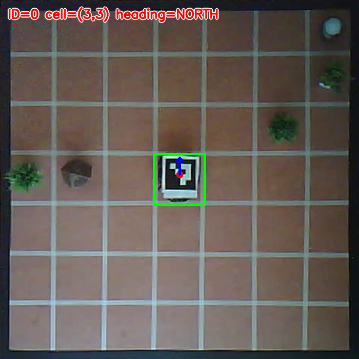
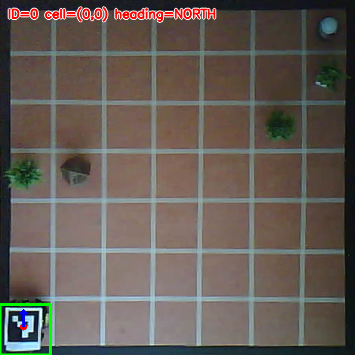
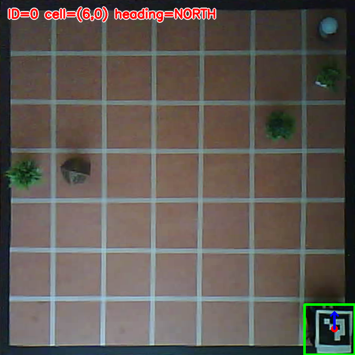
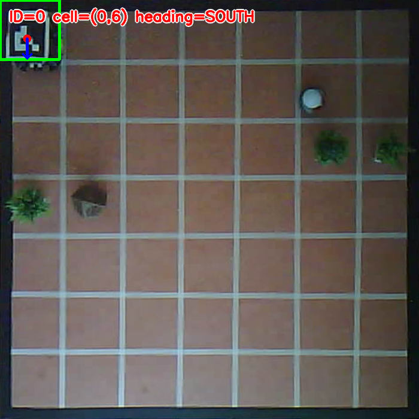
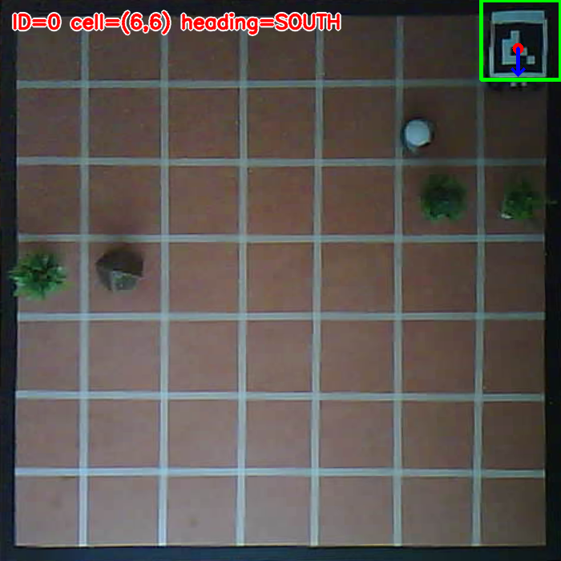

# Implementation Draft I-1.0 - Physical Vision and End-to-End V1 Integration

| Field | Value |
|---|---|
| Status | Complete |
| Date | 2026-10-03 |
| Completed | 2026-10-26 |
| Repository branch | `implementation/i-1.0` |

## 1. Objective

I-1.0 integrates the validated I-0.8 software architecture with the physical
prototype established and calibrated through I-0.9.

Its objective is to complete the physical Version 1 mission while preserving
the existing separation of responsibilities:

- the fixed overhead ESP32-CAM provides global visual observations;
- the Arduino UNO R4 Minima performs low-level actuation and immediate local
  sensor reactions;
- the validated Brain, Planning, Control, Memory, and Perception boundaries
  remain responsible for high-level mission behaviour;
- hardware-specific details remain isolated in adapters and explicit tools.

The final I-1.0 system must convert physical observations into the same
platform-independent domain values already exercised by the deterministic
simulation.

## 2. Transition from I-0.9

I-0.9 validated the first physical hardware prototype, including:

- light-triggered mission activation;
- independently controlled TT motors;
- local infrared obstacle reactions;
- frontal ultrasonic distance measurement;
- black-boundary detection;
- motor restart assistance after reverse and turning manoeuvres;
- combined light and distance confirmation near the target;
- two consecutive complete physical regression missions.

I-1.0 does not replace this hardware baseline. It extends it with global
camera-based localization, explicit microcontroller communication, calibrated
grid movement, and complete physical mission orchestration.

## 3. Scope Boundary

I-1.0 includes:

- fixed overhead ESP32-CAM capture over Wi-Fi;
- validation of stable camera operation;
- perspective calibration of the physical grid;
- conversion between source-image pixels and logical grid cells;
- robot identification, position, and cardinal-heading estimation;
- a physical adapter compatible with the existing `PerceptionPort`;
- explicit communication between the host software and Arduino firmware;
- calibrated 20 cm cell traversal;
- repeatable cardinal rotations;
- physical execution of planned paths;
- integrated target, obstacle, safety, collection, and return behaviour;
- complete end-to-end physical V1 acceptance scenarios.

I-1.0 does not include:

- the planned second robot;
- competitive or cooperative multi-robot missions;
- the future line-following specialization of the first prototype;
- dynamic relocation of the overhead camera during a mission;
- production-grade localization redundancy;
- Version 2 behaviour.

Those capabilities remain outside the Version 1 completion boundary.

## 4. Fixed Overhead Grid Baseline

The operational camera-visible grid uses the following geometry:

| Property | Value |
|---|---|
| Logical columns | 7 |
| Logical rows | 7 |
| Physical cell size | 20 cm by 20 cm |
| Operational grid size | 140 cm by 140 cm |
| ESP32-CAM source resolution | 800 by 600 pixels |
| Rectified resolution | 700 by 700 pixels |
| Rectified pixels per cell | 100 |
| Logical origin | Bottom-left cell `(0, 0)` |

The external white area surrounding the black grid boundary remains available
as a physical safety margin. It is not part of the logical 7 by 7 planning
space.

The camera is installed at a fixed elevated position and points downward toward
the complete operational grid. It is powered independently through a 5 V, 2 A
powerbank.

A continuous camera experiment ran for approximately 30 to 40 minutes without
a connection or image failure.

The camera calibration remains valid only while the camera position, angle,
resolution, and visible grid boundaries remain unchanged. The rectified
reference must be reviewed after every camera removal or powerbank service.

## 5. Perspective Calibration

The current source-image calibration uses four ordered inner black-boundary
corners:

| Corner | Source x | Source y |
|---|---:|---:|
| Top-left | 106.0 | 1.0 |
| Top-right | 597.0 | 2.0 |
| Bottom-right | 588.0 | 471.0 |
| Bottom-left | 122.0 | 480.0 |

The versioned calibration is stored in:

`configs/hardware/grid_calibration_7x7.yaml`

The source and rectified references are stored in:

- `docs/assets/i-1.0/images/grid-reference-7x7-svga.jpg`;
- `docs/assets/i-1.0/images/grid-reference-7x7-rectified.jpg`.

`tools/calibrate_grid.py` provides an explicit four-corner calibration workflow.
It writes both the YAML configuration and a reviewable rectified reference.

The camera IP address is not stored in the calibration because it can change
through DHCP. Runtime commands receive the current camera HTTP origin
explicitly.

## 6. Camera Capture and Rectification Pipeline

The current physical vision pipeline is:

1. `Esp32CameraClient` retrieves one JPEG frame from `/capture`.
2. The JPEG boundaries are validated before decoding.
3. `CalibratedGridCamera` decodes the frame through OpenCV.
4. The source dimensions are checked against the stored calibration.
5. The perspective transform produces a 700 by 700 rectified grid image.
6. Hardware and network failures are exposed through explicit adapter errors.

The following tools support controlled diagnostics:

- `tools/check_esp32_cam.py` validates raw HTTP JPEG capture;
- `tools/calibrate_grid.py` creates the perspective calibration;
- `tools/check_calibrated_grid.py` captures and rectifies a live grid frame;
- `tools/check_robot_pose.py` localizes and annotates the configured robot
  marker.

The live calibrated pipeline has been exercised successfully against the fixed
ESP32-CAM.

## 7. ArUco Robot Localization

The Version 1 robot is assigned:

| Property | Value |
|---|---|
| Dictionary | `DICT_4X4_50` |
| Marker identifier | `0` |
| Printed image size | 8 cm by 8 cm |
| Marker asset | `docs/assets/i-1.0/images/robot-marker-aruco-id-0.png` |

The top edge of the printed marker must point toward the physical front of the
robot.

`ArucoRobotDetector` converts one rectified marker detection into:

- the decoded marker identifier;
- the rectified center coordinates;
- a zero-based logical `Position`;
- a cardinal `Heading`;
- the existing immutable `RobotPose` domain value.

The coordinate conversion applies these rules:

- image columns increase toward the right;
- image rows increase toward the bottom;
- logical `x` increases toward the right;
- logical `y` increases toward the top;
- image-up maps to `NORTH`;
- image-right maps to `EAST`;
- image-down maps to `SOUTH`;
- image-left maps to `WEST`.

The detector refuses to fabricate a pose when marker `0` is missing. It also
rejects a frame when the configured identifier appears more than once.

Synthetic tests validate all four headings, opposite image and domain
y-directions, corner cells, invalid identifiers, missing markers, and duplicate
markers.

The printed marker was mounted flat on the robot roof and physically validated
on 2026-10-05. Live overhead localization correctly identified all four
cardinal headings at logical position `(3, 3)` and correctly classified the
four operational corner cells `(0, 0)`, `(6, 0)`, `(6, 6)`, and `(0, 6)`.

The perspective calibration describes the floor plane while the marker is
elevated on the robot roof. A small expected parallax therefore appears near
the outer grid boundaries. Keeping the robot and marker toward the center of
each cell preserved complete marker visibility and produced the correct
logical pose. One initial detection miss near the upper boundary was resolved
by moving the robot inward within the same cell; no calibration change was
required.

### 7.1 Physical Localization Evidence

| Grid center | Bottom-left corner | Bottom-right corner |
|---|---|---|
|  |  |  |

| Top-left corner | Top-right corner |
|---|---|
|  |  |

## 8. Completed I-1.0 Batches

| Commit | Delivered capability |
|---|---|
| `83da8c5` | ESP32-CAM HTTP capture adapter |
| `804dc1e` | Overhead grid perspective calibration |
| `ca81693` | Live calibrated grid capture |
| `64bd12a` | ArUco robot localization |
| `b565fda` | Physical grid `PerceptionPort` adapter |
| `17fbf5c` | Physical ArUco localization across the operational grid |
| `be37788` | Versioned `ALR|1` Arduino serial protocol |
| `5e866ea` | Safe Arduino serial transport |
| `967d95c` | Optional PySerial connection |
| `b016fae` | Sequenced supervised Arduino serial client |
| `e989267` | Safe supervised Arduino handshake firmware |
| `628733e` | Read-only physical Arduino serial diagnostic |
| `69ff20f` | Physically validated supervised Arduino `STOP` execution |
| `1d7dc60` | Versioned Arduino sensor-snapshot protocol |
| `05d3bbc` | Typed Python Arduino sensor snapshots |
| `8a5726c` | Physically validated read-only Arduino sensor telemetry |
| `392c042` | Deterministic interpretation of raw Arduino sensors |
| `c2d0899` | Arduino sensor fusion with physical grid perception |
| `38940f4` | Physical runtime system clock |
| `a7a6553` | Refreshed physical grid perspective calibration |
| `a68a593` | Adaptive Arduino ambient-light calibration and tracking |
| `b436d08` | Passive fused physical-perception diagnostic |
| `e95eb2c` | Grid recalibration after the fixed camera moved |
| `9c55bff` | Calibrated supervised motor-output preparation |
| `17c75cc` | Disabled bounded-forward execution state machine |
| `b6a98f6` | Enabled bounded supervised forward movement |
| `948a214` | Guarded Python bounded-motion diagnostic |
| `6aca0af` | Bounded camera-confirmed turn primitives |
| `1c26258` | Camera-confirmed physical `ControlPort` |
| `15a0cc7` | Guarded camera-confirmed motion diagnostic |
| `eb24c5d` | Bounded retry for incomplete ESP32-CAM responses |
| `7fc9fa5` | Assisted physical-mission evidence rendering |
| `8ceea9e` | Validated physical obstacle evidence |
| `b7d6426` | Physical obstacle-provenance visualization |
| `45aa757` | Camera grid-cell change detection |
| `f62a483` | Operator-reviewed physical replanning |
| `296100e` | Hardened assisted physical replanning |
| `d43356b` | Completed assisted target-arrival evidence |
| `e3a7a47` | Assisted physical return planning |
| `a42d9cd` | Derived assisted transition headings |
| `10a9b1e` | Configurable assisted camera sensitivity |

The Batch B physical-perception boundary now composes calibrated camera
capture, ArUco localization, deterministic timestamps, and interpreted Arduino
sensor facts into immutable `PerceptionSnapshot` values. Local infrared and
ultrasonic obstacles, the critical boundary hazard, and the debounced light
target are available through the existing platform-independent contract.
Missing or ambiguous localization remains an explicit failure and never
produces a fabricated robot pose.

The Batch C communication boundary now provides a versioned ASCII protocol,
validated request and response objects, a safe serial transport, an optional
PySerial connection, sequenced host exchanges, a supervised I-1.0 firmware,
reproducible diagnostics, typed sensor snapshots, and bounded movement
execution.

The current `i-1.0-bounded-turns-camera-required` firmware accepts
`CMD|STOP` in every safety state and supervised `CMD|MOVE_FORWARD`,
`CMD|TURN_LEFT`, and `CMD|TURN_RIGHT` while safety is rearmed. Accepted
commands return matching `ACK` and terminal `DONE` responses. Forward motion
retains ultrasonic and boundary intervention; every primitive has an absolute
execution bound. The 900 ms turn window is coarse and requires camera
confirmation rather than claiming an independently guaranteed 90-degree turn.

Physical tests confirmed normal `DONE|OK`, ultrasonic `DONE|BLOCKED`,
boundary-triggered `DONE|EMERGENCY_STOP`, active `STOP`, active `ESTOP`, and
automatic motor shutdown after host disconnection. The Python bounded-motion
diagnostic additionally verifies preflight sensors, requires explicit
wheels-lifted authorization, and restores `ESTOPPED/LATCHED`.

Batch C is complete at the bounded primitive boundary. Batch D has a
physically exercised `ControlPort`: Arduino completion is necessary but never
sufficient, and success requires exact post-command camera confirmation of the
adjacent cell or cardinal heading. A left turn was accepted after exact
`NORTH`-to-`WEST` confirmation. Two insufficient right turns and one
insufficient forward movement were rejected and safely returned to
`ESTOPPED/LATCHED`.

These batches preserve the platform-independent I-0.8 core. OpenCV and NumPy
remain optional vision dependencies, and PySerial remains an optional hardware
dependency.

Batch E is complete within the explicitly assisted physical-validation
boundary. The operator supplied the physical displacement that the current
chassis cannot repeat reliably; the software supplied every requested cell and
heading, rejected unobservable frames, retained confirmed obstacles, replanned
both phases, confirmed target collection, and terminated only after exact base
localization.

## 9. Current Verification Record

The current repository, refreshed camera calibration, adaptive light policy,
fused physical perception, bounded motion, and live camera-confirmed control
verification were completed through 2026-10-26. Earlier full-grid ArUco
validation was performed on 2026-10-05.

| Verification | Result |
|---|---|
| ESP32-CAM Wi-Fi connection | Passed |
| Raw `/capture` JPEG retrieval | Passed |
| 800 by 600 source-frame validation | Passed |
| 7 by 7 perspective calibration | Passed |
| 700 by 700 live rectification | Passed |
| Synthetic ArUco ID `0` detection | Passed |
| Four cardinal marker orientations | Passed |
| Logical cell conversion | Passed |
| Missing and duplicate marker rejection | Passed |
| Physical `PerceptionPort` snapshot composition | Passed |
| Physical ArUco marker installation | Passed |
| Physical four-heading validation at `(3, 3)` | Passed |
| Physical corner-cell localization | Passed: `(0, 0)`, `(6, 0)`, `(6, 6)`, and `(0, 6)` |
| Versioned `ALR|1` protocol encoding and decoding | Passed |
| Serial transport connection and timeout handling | Passed |
| PySerial `loop://` integration | Passed |
| UNO R4 Minima bounded-turn firmware compilation and upload | Passed: 48324 bytes flash, 4240 bytes RAM |
| Boot `READY` announcement | Passed |
| Manual `PING`, `STATUS`, `REARM`, and `ESTOP` exchanges | Passed |
| Supervised `CMD|STOP` while `LATCHED` | Passed: matching `ACK`, then `DONE|OK` |
| Supervised `CMD|STOP` while `SAFE` | Passed: matching `ACK`, then `DONE|OK` |
| Live Python `STOP` execution on COM3 | Passed: completion `OK` |
| Read-only `SENSORS` protocol encoding and decoding | Passed |
| Manual `SENSORS` request while `LATCHED` | Passed |
| Physical left and right infrared telemetry | Passed |
| Physical boundary-line telemetry | Passed: raw value changed from `0` to `1` |
| Physical HC-SR04 telemetry | Passed: `196 mm` for a measured 20 cm target |
| Physical photoresistor telemetry | Passed: ambient `314`, illuminated `901` |
| Live typed Python `ArduinoSensorSnapshot` on COM3 | Passed |
| Disabled-lock `CMD|MOVE_FORWARD` rejection | Passed: `BAD_COMMAND`, no wheel movement |
| Bounded forward `ACK/DONE` | Passed: both wheels rotated and stopped automatically |
| Ultrasonic intervention during motion | Passed: `DONE|BLOCKED`, no wheel movement |
| Boundary intervention during motion | Passed: `DONE|EMERGENCY_STOP`, automatic latch |
| Active supervised `STOP` | Passed: rotating wheels stopped immediately |
| Active supervised `ESTOP` | Passed: rotating wheels stopped and safety latched |
| Host disconnection during motion | Passed: motors stopped at the firmware deadline |
| Guarded Python bounded-motion diagnostic | Passed: `DONE|OK`, final `ESTOPPED/LATCHED` |
| Live Python serial diagnostic on COM3 at 115200 baud | Passed |
| Safe boot and final controller state | Passed: `ESTOPPED/LATCHED` |
| Refreshed physical perspective calibration | Passed: 800 by 600 to 700 by 700 |
| Deterministic Arduino sensor interpretation | Passed |
| Physical fused boundary hazard | Passed: boundary true and critical hazard true |
| Physical fused frontal obstacle | Passed: `115 mm` classified as an obstacle |
| Automatic lamp-off ambient calibration | Passed across daylight, dim, near-dark, and ceiling-light conditions |
| Ambient calibration stability | Passed: observed raw ranges from `0` through `2` |
| Validated target-light defaults | Passed: activation `50`, release `30`, five stable readings |
| Physical target activation near 100 cm | Passed under natural, near-dark, and ceiling-light conditions |
| Conservative ambient-baseline tracking | Passed: one-unit tracking while inactive |
| Baseline freezing for target light | Passed throughout candidate and active states |
| Transient low-light ArUco miss | Safely rejected; same frame passed offline and six subsequent live poses passed |
| Live fused physical `PerceptionSnapshot` composition | Passed |
| Physical motor immobility throughout all passive fused tests | Passed |
| `python tools/check_project_structure.py` | Passed |
| Camera-confirmed physical-control unit validation | Passed offline |
| Guarded camera-confirmed `TURN_LEFT` | Passed: `(3,3) NORTH` to `(3,3) WEST` |
| Two insufficient `TURN_RIGHT` attempts | Safely rejected; pose remained `(3,3) WEST` |
| Insufficient 250 ms `MOVE_FORWARD` | Safely rejected; about 11 pixels, same logical cell |
| Final safety state after every live diagnostic | Passed: `ESTOPPED/LATCHED` |
| Interrupted ESP32-CAM response recovery | Passed: three bounded attempts |
| Stable lamp-on obstacle reference | Passed: two captures, zero changed cells |
| Physical camera obstacle proposals | Passed: five operator-confirmed cells |
| Persistent-obstacle A* replanning | Passed across all accepted mission stages |
| Automatic transition heading derivation | Passed for all four cardinal directions |
| Assisted outbound mission | Passed: `(0,0) NORTH` to `(3,4) NORTH` |
| Unobservable planned arrival | Safely rejected: target-lamp glare at `(4,3)` |
| Alternative authorized arrival | Passed: terminal outbound `COMPLETED` |
| Target collection evidence | Passed: `(4,4)` light-off confidence `0.771` |
| Independent assisted return | Passed: `(3,4)` to `(0,0)` |
| Near-dark localization recovery | Passed after diffuse room lighting |
| Final assisted mission state | Passed: `(0,0) WEST`, `COMPLETED` |
| Sixteen-stage visual evidence | Passed: one 4 by 4 and two 4 by 2 storyboards |
| Complete automated test suite | Passed: 677 tests |
| `python -m ruff check .` | Passed |
| `python -m mypy src` plus guarded diagnostic checks | Passed: 68 source files |
| `python -m pip check` | Passed: no broken requirements |
| `python -m build` | Passed: source archive and wheel created |

Physical ArUco validation is complete. The mounted marker was detected in all
four cardinal orientations at the grid center and in all four operational
corner cells. The small boundary parallax caused by marker elevation remains
compatible with cell-level navigation because physical commands will target
cell centers.

The safe serial foundation and stop-only command are physically validated. The
I-1.0 firmware boots with all motor outputs stopped and the safety latch active.
Manual exchanges confirmed liveness, status reporting, explicit rearm,
emergency-stop transitions, and supervised `STOP` execution in both
`LATCHED` and `SAFE` states with matching `ACK/DONE` responses. The live Python
client also completed `STOP` and confirmed the final `ESTOPPED/LATCHED` state.
The boot-only `READY` announcement is not required when reconnecting to an
already running controller; active diagnostics synchronize through
`PING/PONG`.

Read-only sensor telemetry is physically validated. Manual requests confirmed
both infrared channels, black-boundary detection, an HC-SR04 reading of
`196 mm` against a measured 20 cm target, and a photoresistor transition from
`314` ambient to `901` illuminated. The live Python client decoded sequenced
`ArduinoSensorSnapshot` values while the controller remained
`ESTOPPED/LATCHED`.

Raw values are now interpreted deterministically. Infrared polarity,
ultrasonic distance, critical boundary detection, light hysteresis, and
debounce are converted into stable physical facts. A close `115 mm` object
remained a normal frontal obstacle even while the light target activated, and
the black boundary produced a critical hazard.

Lamp-off calibration now derives the baseline automatically from ten stable
samples. The validated policy activates at a relative delta of `50`, releases
at `30`, and requires five consecutive readings. Small inactive-state drift is
followed one raw unit at a time. Tracking freezes for ambiguous, candidate,
and active targets so that the target signal cannot be absorbed.

Live fused camera-and-Arduino perception passed in daylight, dim natural light,
near-dark conditions, and ceiling-light illumination. Target activation passed
near 100 cm with observed deltas of `71` through `73` under ceiling light and
`168` through `170` in near-dark conditions. Every physical run retained
`ESTOPPED/LATCHED`, and both wheels remained stationary.

One ceiling-light capture temporarily missed the ArUco marker and was rejected
without fabricating a pose. The same rectified frame localized successfully
offline, followed by six successful live fused observations.

Authorized target arrival must still combine the confirmed overhead pose,
target light, and short ultrasonic distance. The ultrasonic sensor remains
active near the lamp: its detection of the lamp support becomes arrival
evidence only when the robot is in an authorized target-adjacent cell.
Otherwise the detected object remains a normal obstacle.

Supervised bounded movement is enabled. Movement-specific `ACK/DONE`, local
safety intervention, communication-loss bounds, and camera-confirmed domain
pose evaluation are implemented and physically exercised. Exact confirmed
motion is accepted; insufficient motion is rejected and followed by a latched
emergency stop.

## 10. Planned Integration Batches

### Batch A - Physical Marker Validation

- [x] print the marker at exactly 8 cm by 8 cm;
- [x] preserve its white quiet-zone margin;
- [x] mount it flat on the robot roof;
- [x] align its top edge with the robot front;
- [x] confirm detection in several cells;
- [x] confirm all four cardinal orientations;
- [x] verify detection near the operational grid boundaries.

Batch A is complete. Physical localization passed at the grid center and at all
four operational corner cells.

### Batch B - Physical Perception Adapter

- [x] combine calibrated camera capture and robot localization;
- [x] produce the existing immutable `PerceptionSnapshot`;
- [x] integrate physical target, obstacle, and hazard sources;
- [x] provide explicit failures when localization is unavailable;
- [x] satisfy the existing `PerceptionPort`.

Batch B is complete at the passive physical-perception boundary. Typed Arduino
telemetry is deterministically interpreted and fused with confirmed overhead
pose and timestamps. Automatic ambient calibration, conservative baseline
tracking, target debounce and hysteresis, local obstacle facts, and the
critical boundary hazard are physically validated.

Mission-level target authorization will still require agreement between the
overhead camera pose, stable target light, and short ultrasonic distance.
Ultrasonic protection remains active throughout the approach.

### Batch C - Microcontroller Communication

- [x] define the versioned `ALR|1` host-to-Arduino protocol;
- [x] implement validated request and response encoding;
- [x] implement safe serial transport and explicit timeouts;
- [x] provide the optional PySerial connection;
- [x] implement sequenced host exchanges;
- [x] upload a separate safe I-1.0 supervised firmware;
- [x] validate `PING`, `STATUS`, `REARM`, and `ESTOP` on COM3;
- [x] keep every motor output stopped during handshake validation;
- [x] transmit and physically validate controlled `STOP` commands;
- [x] return matching `ACK` and terminal `DONE` responses for `STOP`;
- [x] transmit bounded movement commands;
- [x] return matching `ACK` and terminal `DONE` responses for movement;
- [x] receive physical sensor telemetry;
- [x] decode sequenced telemetry into typed host snapshots;
- [x] validate all five physical sensor channels while safety remains latched;
- [x] stop safely after communication loss during motion;
- [x] preserve immediate local sensor safety reactions during execution.

The communication, telemetry, and bounded-execution paths are physically
validated. The controller starts in `ESTOPPED/LATCHED`, accepts explicit
safety-state transitions, executes `STOP` in every safety state, and produces
typed five-sensor snapshots without movement while latched.

Batch C is complete. Bounded forward execution returns matching `ACK/DONE`,
retains immediate ultrasonic and boundary protection, stops after host
disconnection, and is exercised through an explicitly authorized Python
diagnostic that always restores the safety latch.

### Batch D - Camera-Confirmed Physical Control

- [x] implement bounded forward and left/right turn primitives;
- [x] implement exact expected-pose calculation for every command;
- [x] implement a physical `ControlPort` with fused pre/post perception;
- [x] reject Arduino completion without matching camera pose;
- [x] normalize blocked, timeout, communication-loss, and emergency outcomes;
- [x] guarantee final emergency-stop cleanup in the guarded diagnostic;
- [x] physically validate an exact camera-confirmed left cardinal turn;
- [x] physically validate safe rejection of insufficient right-turn outcomes;
- [x] physically validate safe rejection of insufficient forward movement;
- [x] record the accepted physical limitations of the current chassis.

The hardware investigation started during I-0.9. The drive motors were changed
to isolate the cause, but the intermittent imbalance remained. Ground tests
nonetheless demonstrated obstacle avoidance and containment inside the black
boundary. Multiple motor offsets, speed values, restart boosts, and movement
durations were calibrated in search of the best alignment. These measures
improved individual runs but did not provide repeatable two-wheel startup.

The I-1.0 camera-confirmed tests now establish the boundary clearly: the
software correctly accepts exact logical motion, rejects insufficient motion,
stops the motors, and restores `ESTOPPED/LATCHED`; the current chassis cannot
reliably realize every requested trajectory. Successful adjacent-cell forward
motion and repeatable right rotation are therefore platform-qualification
targets for a better-adapted replacement robot and future Version 2 work, not
unverified software claims.

### Batch E - End-to-End Physical V1

- [x] execute an assisted planned outbound path from physical base `(0,0)`;
- [x] detect camera scene changes and require explicit obstacle review;
- [x] retain five confirmed physical obstacles across every replan;
- [x] derive the required cardinal heading for each adjacent transition;
- [x] reject missing ArUco observations without fabricating a pose;
- [x] reject an optically unobservable planned arrival;
- [x] complete at an alternative authorized target-adjacent cell;
- [x] confirm collection through the target-lamp state transition;
- [x] calculate an independent obstacle-aware return path;
- [x] recover localization after an ambient-light change;
- [x] confirm final return to physical base with terminal `COMPLETED`;
- [x] preserve sixteen annotated stages as public visual evidence.

The validated scene used target `(4,4)` and obstacles `(0,2)`, `(2,0)`,
`(2,1)`, `(4,2)`, and `(2,4)`. Outbound confirmation ended at alternative
authorized arrival `(3,4) NORTH` after lamp glare made planned arrival `(4,3)`
unobservable. Collection was confirmed by the target light-off transition.
Return planning then followed a distinct route and completed at `(0,0) WEST`.

This is an assisted physical software-validation scenario, not a claim of
repeatable autonomous chassis motion. The operator performed each requested
physical displacement; the software performed perception, validation,
planning, heading derivation, rejection, replanning, and completion.

## 11. Known Limitations

The current I-1.0 implementation has these explicit limitations:

- marker elevation produces small expected parallax near the outer boundaries,
  so planned physical motion must target cell centers;
- camera calibration must be revalidated after camera or powerbank removal,
  reinstallation, or physical movement;
- the camera IP address can change through DHCP;
- the powerbank must be checked and recharged between experiments;
- automatic light calibration requires the target lamp to remain off during
  the initial stable ambient samples;
- abrupt lighting changes outside the conservative tracking band are not
  absorbed and require a fresh lamp-off calibration;
- insufficient grid illumination can cause a transient ArUco miss, which is
  rejected explicitly rather than converted into a fabricated pose;
- camera cell-change detection proposes possible obstacles but deliberately
  requires operator confirmation before modifying the planning world; it does
  not claim autonomous semantic obstacle classification;
- bounded forward and turn primitives are connected through the physical
  `ControlPort`, but physical success still requires charged-battery camera
  confirmation;
- successful primitive completion confirms protocol execution only; the new
  control boundary separately requires the expected logical grid pose;
- fused local sensor facts are available in physical `PerceptionSnapshot`
  values but are not yet consumed by authorized target-arrival execution;
- the open-loop two-wheel chassis exhibits intermittent startup imbalance and
  trajectory drift despite motor changes and repeated I-0.9 calibration, so it
  is not considered suitable for repeatable exact navigation and camera
  confirmation remains mandatory;
- exact 20 cm movements and 90-degree rotations remain uncalibrated;
- the validated I-0.9 autonomous firmware remains preserved as an experimental
  baseline and is not modified by I-1.0;
- assisted end-to-end physical software execution is validated, while
  repeatable motor-driven execution of the same exact paths remains unavailable
  on the current chassis.

## 12. I-1.0 Exit Conditions

- [x] Install the ESP32-CAM at a fixed overhead position.
- [x] Validate stable Wi-Fi JPEG capture.
- [x] Record a camera-visible 7 by 7 operational grid.
- [x] Create and validate a perspective calibration.
- [x] Produce live 700 by 700 rectified frames.
- [x] Define the robot ArUco dictionary and identifier.
- [x] Store the printable robot marker in the repository.
- [x] Validate synthetic cell and heading localization.
- [x] Print and mount the 8 cm by 8 cm robot marker.
- [x] Validate real marker detection across the physical grid.
- [x] Implement the physical `PerceptionPort` adapter.
- [x] Implement and physically validate the safe Arduino serial handshake.
- [x] Implement and physically validate supervised `STOP` execution.
- [x] Implement and physically validate read-only Arduino sensor telemetry.
- [x] Interpret and fuse physical target, obstacle, and boundary-hazard facts.
- [x] Validate automatic ambient calibration and target-light tracking.
- [x] Implement explicit host-to-Arduino movement execution.
- [x] Validate movement `ACK/DONE` and communication-loss behaviour.
- [x] Implement camera-confirmed physical movement evaluation.
- [x] Prepare an explicitly authorized camera-confirmed motion diagnostic.
- [x] Exercise camera-confirmed movement with a charged battery.
- [x] Validate exact left-turn acceptance and safe rejection of insufficient
  forward and right-turn outcomes.
- [x] Document that repeatable precision requires a better-adapted robot.
- [x] Integrate physical target and obstacle observations.
- [x] Execute a complete assisted outbound, collection, and return mission.
- [x] Run complete physical V1 regression scenarios.
- [x] Update the public README and command-line status.
- [x] Review and merge the I-1.0 pull request.

I-1.0 is complete. Every physical-integration and repository closure
condition has been satisfied.